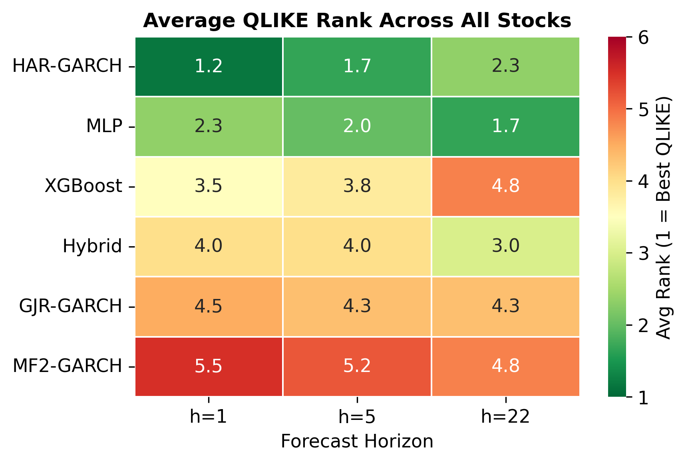
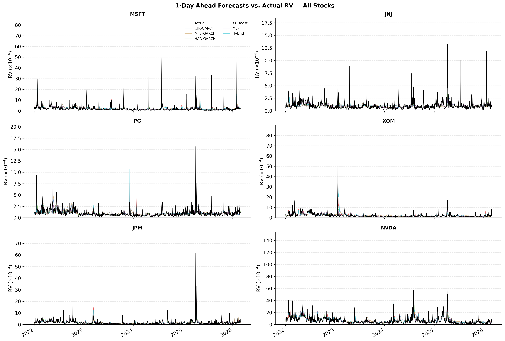

# Volatility Forecasting: GARCH-type Models vs. Machine Learning

**Which model class forecasts realized volatility better depends almost entirely on the horizon — not on the model class.**

M.Sc. Economics thesis, Heidelberg University. Out-of-sample comparison of three GARCH-type
econometric models, two machine-learning models and one hybrid, across six U.S. equities from
six different sectors, at 1-day, 1-week and 1-month horizons.



---

## Key findings

1. **At the 1-day horizon the simple econometric benchmark wins.** HAR-GARCH takes the best
   average QLIKE rank (1.17 of 6). For NVDA it is the *only* model that survives the Model
   Confidence Set — every other specification is statistically eliminated.

2. **By the 1-month horizon the ranking inverts.** The MLP moves to first (1.67) and HAR-GARCH
   drops to 2.33. The practical question is therefore not "GARCH or ML?" but "what horizon are
   you forecasting?"

3. **Hybridisation mostly did not pay off.** Feeding MF2-GARCH volatility components into
   XGBoost improved the tree model only at h=22 (rank 4.0 → 3.0) and never beat the far simpler
   MLP. Econometric structure helps a data-driven forecaster less than the literature suggests.

A fourth result worth flagging: among the ML models, the **most parsimonious one wins**. The MLP
uses four inputs; XGBoost uses seven and finishes 1–3 ranks behind it at every horizon.

## Why this matters

Realized-volatility forecasts feed VaR models, option pricing, risk limits and position sizing.
The horizon dependence found here has a direct operational reading: a desk managing overnight
risk should stay with HAR; a risk function setting monthly capital has a genuine reason to look
at machine learning. Picking one model class for all horizons costs accuracy either way.

## Data

| | |
|---|---|
| Source | VOLARE high-frequency financial database |
| Period | 2015-01-02 – 2026-03-31 (2,783 daily observations per stock) |
| Target | `rv5` — realized variance from 5-minute intraday returns |
| Returns | `ret` — open-to-close log return, `100 × log(close_t / open_t)` |
| Assets | MSFT (Tech), NVDA (Tech), JNJ (Healthcare), PG (Consumer Staples), XOM (Energy), JPM (Financials) |

**The raw data is not in this repository.** VOLARE is a licensed database and cannot be
redistributed — see [`data/README.md`](data/README.md) for how to obtain it and what the pipeline
expects. Everything else needed to verify the results (code, forecasts, metrics, figures, tables)
is included.

One design choice worth calling out: `ret` is deliberately the **open-to-close** return, not
close-to-close. It spans the same 09:30–16:05 session over which VOLARE computes `rv5`, so the
GARCH-family models forecast the conditional variance of the very quantity being evaluated. A
close-to-close return would carry the overnight move that `rv5` does not capture, putting those
forecasts on a systematically larger scale than the target.

## Models

| Model | Class | Specification |
|---|---|---|
| GJR-GARCH | Econometric | Asymmetric GARCH benchmark, leverage effect |
| HAR-GARCH | Econometric | Corsi (2009) daily/weekly/monthly log-RV + LHAR leverage term |
| MF2-GARCH | Econometric | Conrad & Engle (2025), short-run GARCH × long-run MEM component |
| XGBoost | ML | Gradient-boosted trees, 7 features |
| MLP | ML | 64–32–16 network, 4 features, one regressor per horizon |
| Hybrid | Hybrid | XGBoost + MF2-GARCH in-sample components as extra features |

## Forecast design

Strict out-of-sample, rolling 1,000-day window, re-estimated every 5 days, test period from
2022-01-01. Horizons: 1, 5 and 22 trading days.

Evaluation uses **MSE** and **QLIKE** (Patton, 2011 — robust to noise in the RV proxy) and the
**Model Confidence Set** (Hansen, Lunde & Nason, 2011), which tests all six models jointly at
each stock and horizon. Pairwise Diebold–Mariano tests are deliberately omitted: averaging DM
statistics over six stocks is a descriptive summary, not a valid combined test, whereas the MCS
already handles the multiple-comparison problem.

## Results

Average QLIKE rank across the six stocks (1 = best):

| Model | h=1 | h=5 | h=22 |
|---|---|---|---|
| HAR-GARCH | **1.17** | **1.67** | 2.33 |
| MLP | 2.33 | 2.00 | **1.67** |
| Hybrid | 4.00 | 4.00 | 3.00 |
| GJR-GARCH | 4.50 | 4.33 | 4.33 |
| XGBoost | 3.50 | 3.83 | 4.83 |
| MF2-GARCH | 5.50 | 5.17 | 4.83 |

Model Confidence Set membership is in [`results/tables/tab4_mcs_per_stock.csv`](results/tables/tab4_mcs_per_stock.csv).
It sharpens the picture considerably — for PG and XOM at h=1 the set narrows to just
{HAR-GARCH, MLP}, and for NVDA at h=1 to HAR-GARCH alone.



Full per-stock accuracy is in [`results/tables/tab2_per_stock_accuracy.csv`](results/tables/tab2_per_stock_accuracy.csv);
rolling parameter paths, forecast series and per-model metrics are under [`results/`](results/).

## Limitations

- **Six stocks, all large caps.** Enough to show the horizon effect across sectors, not enough
  to claim it generalises to small caps or non-U.S. markets.
- **Statistical loss only.** MSE and QLIKE say which forecast is closer, not whether the
  difference is worth money. An economic-value evaluation (VaR backtest, option-pricing P&L,
  or a volatility-targeting strategy) would be the natural next step.
- **MCS is run per stock**, not as a panel — so the results describe six separate horse races
  rather than one pooled verdict.
- **The RV proxy is itself noisy.** QLIKE is chosen precisely because it is robust to this, but
  no evaluation against a latent target is fully clean.

## Repository structure

```
config.py                  Global settings: assets, horizons, windows, features, paths
notebooks/
  1_feasibility_test.ipynb Exploratory analysis + single-stock feasibility check (provenance only)
  2_feature_engineering.ipynb  Builds features and forecast targets
  3_forecasts.ipynb        Rolling-forecast pipeline runner
  4_outputs.ipynb          Tables, figures and statistical tests
src/models/                One module per model
src/evaluation/            MSE / QLIKE losses, Model Confidence Set
results/
  forecasts/               {TICKER}_{MODEL}.csv — 6 stocks x 6 models
  metrics/                 MSE + QLIKE per horizon
  tables/                  Rolling parameter estimates + thesis tables tab1–tab5
  figures/                 fig1–fig12
```

## Reproducing

```bash
pip install -r requirements.txt
```

Place the VOLARE extract at `data/raw/realized_var_stocks.csv` (see [`data/README.md`](data/README.md)),
then run the notebooks in order: `2_feature_engineering` → `3_forecasts` → `4_outputs`.
Notebook 1 is kept for provenance and is not required by the pipeline.

The full rolling-forecast run is expensive — six models re-estimated every five days over a
1,000-day window for six stocks. `results/` is committed so the figures and tables can be
verified without re-running anything.

## References

Conrad, C., & Engle, R. F. (2025). Modelling Volatility Cycles: The MF2-GARCH Model.

Corsi, F. (2009). A Simple Approximate Long-Memory Model of Realized Volatility. *Journal of Financial Econometrics*.

Corsi, F., & Renò, R. (2012). Discrete-Time Volatility Forecasting with Persistent Leverage Effect. *Journal of Business & Economic Statistics*.

Glosten, L. R., Jagannathan, R., & Runkle, D. E. (1993). On the Relation between the Expected Value and the Volatility of the Nominal Excess Return on Stocks. *Journal of Finance*.

Hansen, P. R., Lunde, A., & Nason, J. M. (2011). The Model Confidence Set. *Econometrica*.

Patton, A. J. (2011). Volatility Forecast Comparison Using Imperfect Volatility Proxies. *Journal of Econometrics*.

## Author

**Baojing Cai** — M.Sc. Economics, Heidelberg University
Supervisor: Prof. Christian Conrad

Code is MIT-licensed (see [LICENSE](LICENSE)). The thesis text itself is not included in this
repository.
